# YFC implementation guide

This is the map of the system. It explains how the pieces fit, how a request moves, and how business data moves from a public enquiry to a delivered trip and a reviewed bill. Field-by-field contracts stay in the domain guides listed at the end. Those guides are the source of truth for request bodies. This document is the source of truth for structure and flow.

YFC Transport & Materials is an internal operations system for selling and moving bulk material, holding it in yards, running owned trucks, and keeping a manual accounting book in INR. Quantities are tonnes. Commercial subtotals exclude tax until an accountant types GST on one bill. The Spring Boot API is authoritative. The React workspace only displays server results and submits what the API already accepts.

## 1. Repository

```text
YFC/
  backend/          Java 21, Spring Boot 4.1.1, Spring Modulith, Flyway, PostgreSQL
  frontend/         React 19, Vite 7, TypeScript, the staff workspace and the public site
  docs/             Domain guides. This file is the overview.
```

There is no second application. `frontend/` serves both the public company site and the signed-in workspace. The backend does not serve the SPA. In local development Vite proxies `/api`, `/login`, and `/logout` to `http://127.0.0.1:8080`.

## 2. Runtime

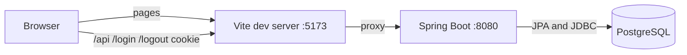

Production is the same split on one origin: the web server serves `frontend/dist` and forwards `/api`, `/login`, and `/logout` to Spring Boot. Session cookies stay on that origin. Nothing in the browser stores a token or a password.

Local and AWS database setup is in [local environment](local-environment.md) and [AWS database](aws-database.md).

## 3. One write, end to end

Every staff write follows this path. Reads skip CSRF and do not change rows.

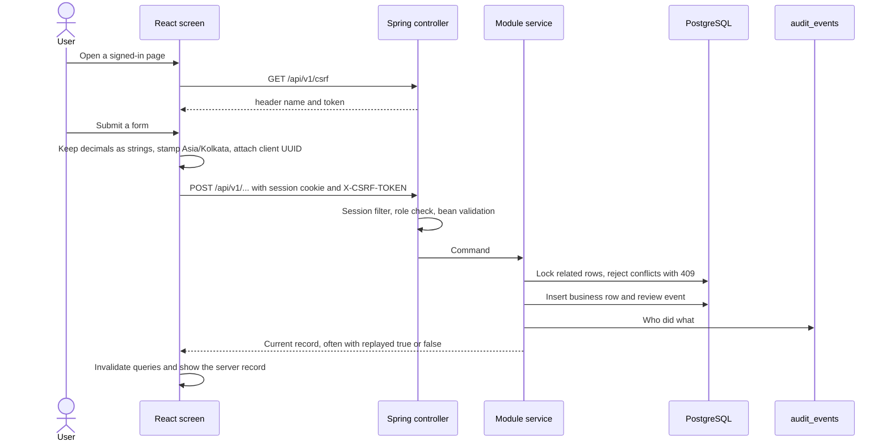

Rules that apply to almost every command:

- The client generates the record or event UUID (`IdField` uses `crypto.randomUUID()`). Sending the same id with the same payload is a safe retry. Sending it with different data returns 409.
- A review is a second person. The submitter cannot approve their own request. `SUPER_ADMIN` may submit and may review other people’s work, but cannot self-review.
- Money and stock totals are calculated on the server. The UI sends quantities and prices as decimal strings so JavaScript does not round them.
- Datetimes entered as `datetime-local` are sent with a `+05:30` offset. Dates are calendar dates, not instants.
- A 401 means the session is gone. A 403 refreshes the CSRF token and shows the server detail when the body has one.
- Lists are either a Spring `Page` (`content`, `totalElements`) or a raw array, newest or oldest depending on the endpoint, page size 1–100. The UI treats a full page of 20 as “there may be another page” when the API does not return `totalPages`.

## 4. Backend modules

Spring Modulith treats each direct package under `com.yfctransport` as a module. `ArchitectureTest` fails the build if a module reaches into another module’s internals. Cross-module reads go through a small registry, not through another module’s repository.

| Module | Owns | Talks to other modules through |
| --- | --- | --- |
| `identity` | Users, roles, sessions, password reset, login lockout | Account id used by portal ownership |
| `platform` | CSRF token endpoint, API error shape | — |
| `audit` | Append-only `audit_events` | Called by services after a successful change |
| `branches` | Branches | Read by yards, drivers, journals, purchases |
| `materials` | Material catalogue | Snapshotted onto orders and purchases |
| `customers` | Customers, projects, sites | `CustomerRegistry` for orders |
| `suppliers` | Suppliers, plants, plant materials | Purchases and the public site |
| `orders` | RFQs, quotations, sales orders, legacy dispatch weights | Fulfillment read by trips and purchases |
| `inventory` | Yards, stock, purchases, receipts, reservations, adjustments | Stock movements |
| `fleet` | Trucks and compliance | `TruckRegistry` for trips and fuel |
| `logistics` | Drivers, trips, incidents, customer returns | Orders, inventory, fleet |
| `fuel` | Diesel rates, fuel receipts, expenses, odometer resets, fuel allocations | Trips and trucks |
| `documents` | Private files stored in the database | Target id only; it does not parse the business record |
| `accounting` | Chart, periods, journals, parties, money vouchers, billing | Reads posted business facts; does not mutate stock |
| `site` | Public catalogue, enquiries, quote desk | Creates nothing in the sales order book until staff convert it |
| `portal` | External home for customer, supplier, driver | Reads only the row linked in `account_ownership` |

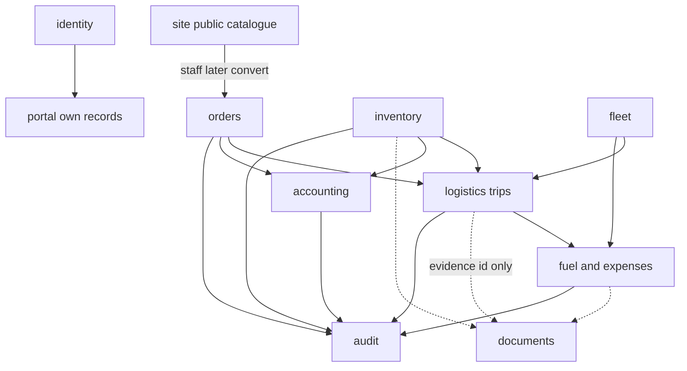

A dotted line means the business row stores a text reference such as `document:<uuid>`. Uploading a file does not fill that field. The user copies the id if they want the evidence text to point at the file.

## 5. Persistence

Flyway owns the schema. Hibernate does not create tables. Migrations `V1` through `V22` are the history:

| Versions | What they introduced |
| --- | --- |
| V1 | Customers, orders, legacy dispatch weights |
| V2 | Trucks and fuel |
| V3 | Users, sessions, audit |
| V4 | Branches, materials, suppliers, plants, projects, sites |
| V5 | RFQ and quotation workflow |
| V6 | Yards, purchases, receipts, reservations, stock movements |
| V7 | Drivers and trips |
| V8 | Fuel review and operating expenses |
| V9 | Trip incidents |
| V10 | Private documents |
| V11 | Reviewed stock adjustments and customer returns |
| V12 | Chart of accounts, periods, journals |
| V13 | Party financial profiles |
| V14 | Money vouchers and cash/bank books |
| V15 | Billing preparation |
| V16 | Weight corrections, purchase-receipt reversals, crew reassignment |
| V17 | Further execution corrections |
| V19 | Yard kind, quarantine, odometer resets, fuel allocations, stock document targets |
| V20 | External account requests and bill tax |
| V21 | Public site content |
| V22 | Customer address |

V18 is not in the tree. Do not invent a V18 file to “fill the gap”; later versions are already applied on databases that migrated in order.

### Core records

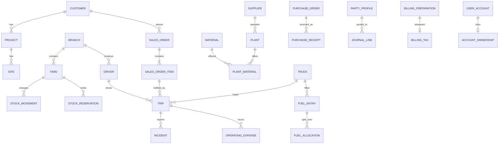

Stock is not a single balance column that the UI edits. On-hand and reserved quantities are derived from `stock_movements` plus reservation rows. A screen that shows a balance is reading the server’s current sum.

## 6. People and what they can open

Spring Security requires a session for every API except health, CSRF, password reset, anonymous account applications, and the public site reads and quote/enquiry posts. Method security (`@PreAuthorize`) then checks the role. The React shell hides links the role cannot use, and also redirects direct URLs. The API still decides.

| Role | Workspace | May submit | May review | Must not |
| --- | --- | --- | --- | --- |
| `SUPER_ADMIN` | Every staff screen, including People and Audit | Operational writes and finance setup | Other people’s submissions | Review their own submission. Edit a yard kind later. |
| `OPERATIONS` | Sales, masters, supply, fleet, trips, fuel, account requests, customer site | Orders, purchases, trips, stock requests, fuel, expenses | — | Open ledger, journals, billing, people, or audit. Approve their own fuel or stock request. |
| `ACCOUNTS` | Sales and supply read, trips read, fuel read, all finance screens | Journals, vouchers, billing, GST, chart and period setup where the API allows accounts | Fuel, expenses, stock, returns, odometer resets, allocations, receipt reversals, weight corrections | Register trucks, allocate trips, post purchases, or open People. |
| `CUSTOMER` | External home only | — | — | See any other customer, or any staff screen |
| `SUPPLIER` | External home only | — | — | See other suppliers |
| `DRIVER` | External home only | — | — | See other drivers or the staff nav |

Login lockout is five failures in fifteen minutes. The failure response is HTTP 401 with an empty message, the same shape as a wrong password. Passwords are bcrypt hashes. The UI can show a password while it is being typed. It cannot show a password after it is saved.

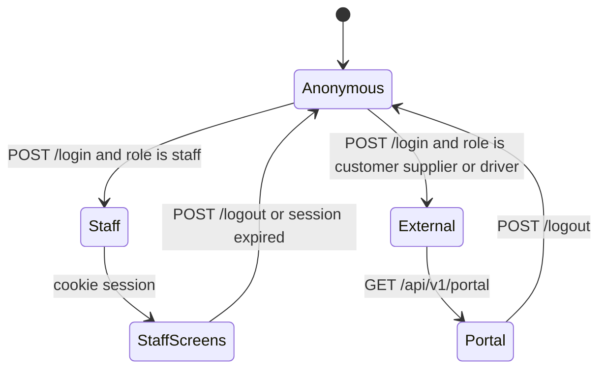

An external login with no `account_ownership` row gets 404 from the portal: “No records are linked to this login.” That happens if someone is given the role without going through account-request approval.

## 7. Frontend

`frontend/src/main.tsx` is the shell. It loads `GET /api/v1/auth/me`, builds an `Access` object, and chooses the tree:

- `/` public site, no session required
- `/signup` customer sign-up on the public site
- `/join` customer, supplier, or driver account request
- `/reset` password reset with a token from People
- no session: login form
- customer, supplier, or driver: `ExternalHome` in `portal.tsx`
- staff: sidebar and routes below

| Route | Screen file | Data it loads |
| --- | --- | --- |
| `/dashboard` | `overview.tsx` | Orders, RFQs, latest trips. Writers also load fleet compliance. Finance also loads expenses. Admin and operations also load pending account requests and the public desk. |
| `/sales`, `/sales/:id` | `sales.tsx` | RFQs and quotations |
| `/orders`, `/orders/:id` | `sales.tsx` | Sales orders and fulfillment |
| `/customers` `/materials` `/suppliers` `/branches` | `masters.tsx` | Those catalogues, plus projects, sites, and plants |
| `/yards` `/purchases` `/reservations` `/stock` | `supply.tsx` | Yards, purchases, reservations, counts, openings, transfers, reversals, supplier returns |
| `/fleet` | `fleet.tsx` | Trucks, drivers, compliance. Hidden unless the user can write operations. |
| `/trips`, `/trips/:id` | `fleet.tsx` | Trips, costs, incidents, returns, weight corrections |
| `/operating` | `operating.tsx` | Fuel, expenses, allocations, odometer resets, diesel rates |
| `/ledger` `/parties` `/money` `/billing` | `finance.tsx` | Chart, periods, journals, parties, vouchers, billing. Hidden unless the user is accounts or admin. |
| `/people` `/audit` | `admin.tsx` | Users and audit events. Admin only. |
| `/account-requests` | `portal.tsx` | Pending applications. Admin and operations. |
| `/site` | `site-desk.tsx` | Public catalogue and quote desk. Admin and operations. |

Shared pieces live in `api.ts` (cookie fetch, CSRF, errors), `lib.ts` (decimals, IST, yard kind, “did I submit this?”), `ui.tsx` (`SaveForm`, `ReviewBox`, `Choices`, tables), and `documents.tsx` (upload and download).

The overview does not invent company-wide KPIs. A card that says “latest 100” counted at most 100 server rows. Empty tables mean the API returned an empty list, not that the screen failed.

## 8. Business data flows

### 8.1 Public site to a sales order

The public site is content plus two anonymous writes. It does not create a sales order.

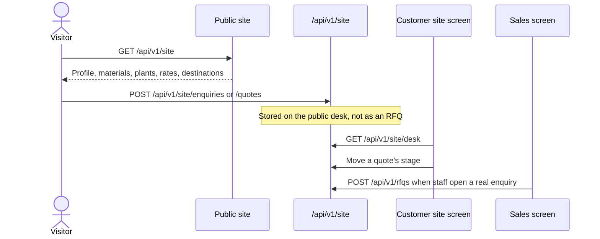

Staff still create the commercial RFQ themselves. “Record as sent” on a quotation stores the fact that it was sent. It does not email or message the customer.

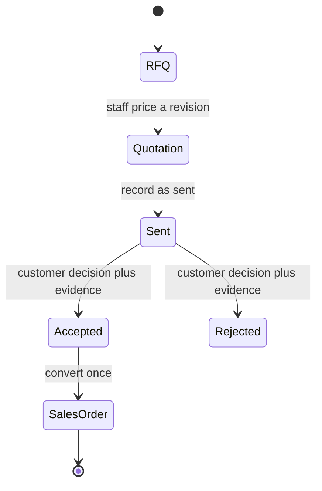

Conversion copies material, site, quantities, and prices onto the order. Later catalogue edits do not rewrite the order. Manual orders are a separate path for work that did not start as an RFQ. Legacy weighbridge rows can still be recorded on an order; they are not the trip workflow.

Guide: [sales workflow](sales-workflow.md).

### 8.2 Account request to a portal

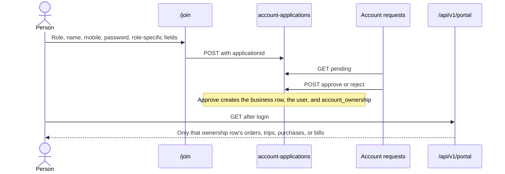

No email is sent. The person uses the username and password they chose, after approval. Disapproval frees the username so they can apply again. Driver approval must name an active branch.

Guide: [external accounts](external-accounts.md).

### 8.3 Purchase into a yard, then onto a trip

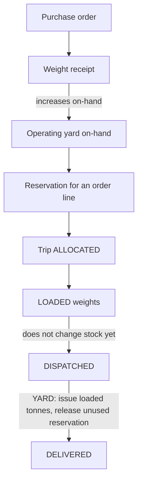

Yard kind is chosen at creation and never edited.

- `OPERATING` can receive purchases, reservations, and trip issues.
- `QUARANTINE` is held material. It is not a purchase destination.
- A direct purchase names an order line instead of a yard. Its receipt is tied to the trip and does not increase yard stock.
- A transfer between two operating yards may cross branches. It moves quantity only. It does not post a journal.
- Any transfer that touches a quarantine yard must stay inside one branch.

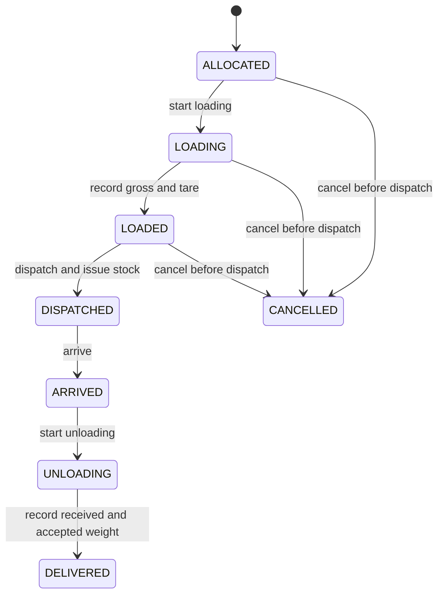

After dispatch, staff can reassign the truck and driver until delivery. A delivered weight correction is a separate reviewed request. It does not silently put unused tonnes back on the yard. Customer returns are the path that puts accepted material back, and only after accounts approve.

`TRANSPORT` orders describe material the truck carries. They do not move YFC yard stock.

Guides: [purchasing and inventory](purchasing-inventory.md), [trips and fleet](trips-and-fleet.md), [returns and stock adjustments](returns-and-stock-adjustments.md).

### 8.4 Stock that waits for a second person

Counts, opening balances, transfers, supplier returns, customer returns, and purchase-receipt reversals share one shape:

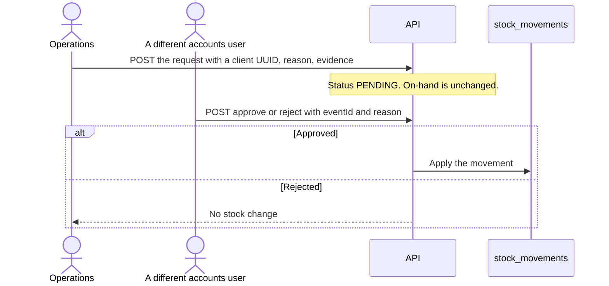

Customer return rules, after approval:

| Resalable | Yard | Effect |
| --- | --- | --- |
| yes | operating, same branch as the order | On-hand increases |
| no | operating | Return capacity is consumed. On-hand does not increase. |
| no | quarantine, same branch | That yard’s on-hand increases so the held material is visible |

Opening stock is a quantity, not an opening-balance journal. Supplier returns put accepted yard purchases back to the supplier and reduce on-hand. An approved count or return can itself be reversed by a second reviewed request.

### 8.5 Fuel, expenses, and the truck

Fuel and expenses record money that was spent on the road. They are not journal entries. Trip operating cost is the sum of approved fuel and expenses, including approved allocations. Rejected and reversed rows drop out of that sum.

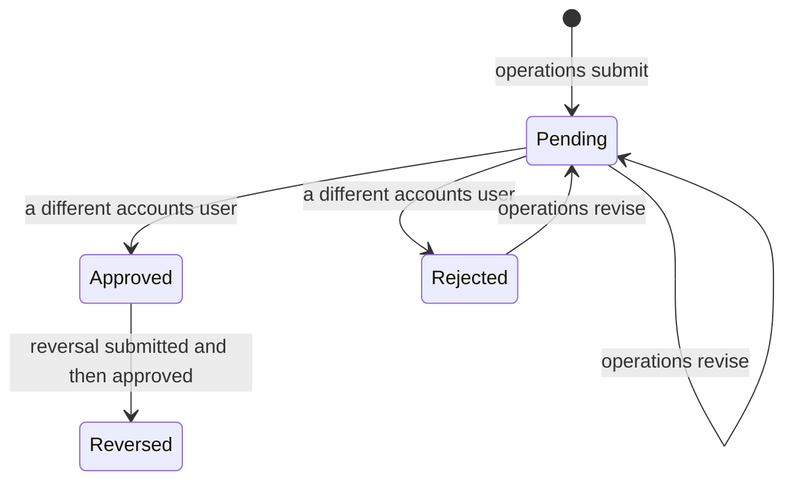

Important splits:

- A fuel receipt that names a trip is wholly that trip’s. It cannot be split.
- An approved receipt with no trip can be allocated across trips. Litres pending plus litres approved cannot exceed the receipt. The amount is litres times the receipt price, half-up, on the server. The truck must be the trip’s truck, and the fill time must fall inside the trip window.
- A pending allocation must be rejected before that fuel receipt can be reversed.
- An odometer reset is one pending request per truck. `resetAt` cannot be in the future. After approval, later fuel readings may be lower than fills from before the reset. This is not tank balance and it is not mileage.
- Diesel pump rates are an admin master. The receipt stores the actual price paid. Those two numbers are allowed to differ; a variance reason explains it.

Guide: [fuel and operating expenses](fuel-and-operating-expenses.md).

### 8.6 Documents

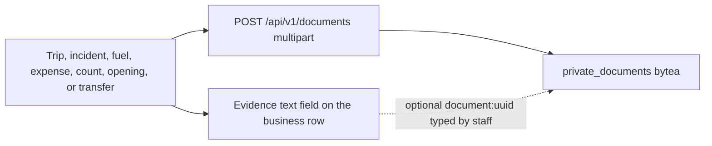

Allowed targets: `TRIP`, `INCIDENT`, `FUEL`, `EXPENSE`, `STOCK_ADJUSTMENT`, `STOCK_TRANSFER`, `STOCK_OPENING`. Files are PDF, JPEG, or PNG, at most 2 MB, stored in PostgreSQL. There is no S3 path.

Guide: [private documents](private-documents.md).

### 8.7 Accounting

Operations data does not post itself into the ledger. An accountant copies a ready commercial fact into a journal, or writes a manual journal. Transfers, fuel, odometer resets, and allocations do not create journals.

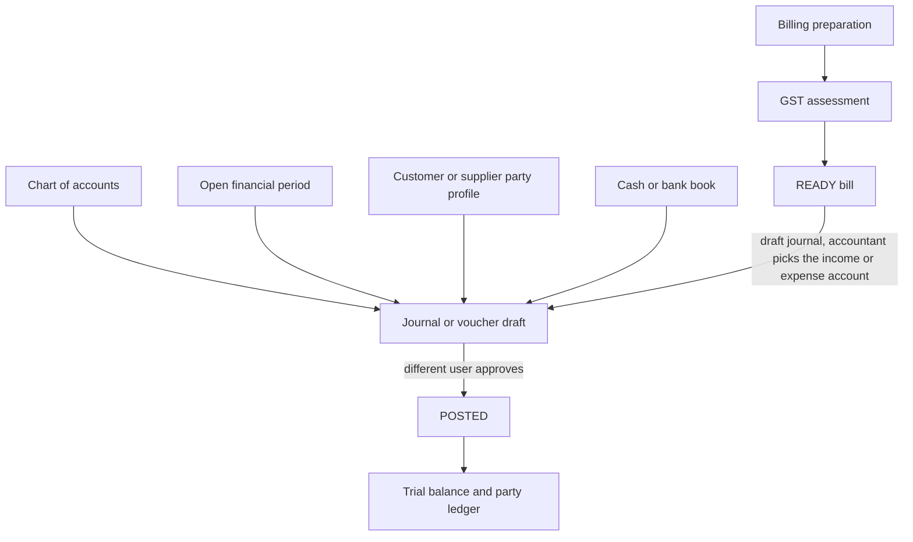

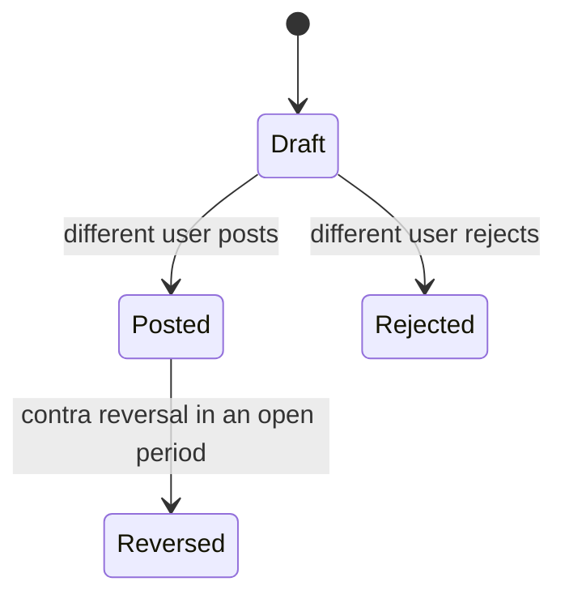

Billing preparation snapshots the order or the supplier receipt. It is not a government e-invoice. GST is entered on that one bill. A sales bill can then receive an invoice number. Payment allocation, bank feeds, stock valuation, TDS, and opening-balance journals are not implemented. Closing a period blocks further posting into it.

Guides: [accounting foundation](accounting-foundation.md), [party accounts](party-financial-accounts.md), [receipts and payments](receipts-and-payments.md), [billing preparation](billing-preparation.md).

### 8.8 Audit

Successful commands append a row to `audit_events`: actor, action, entity type, entity id, and a short detail. People can read this only as `SUPER_ADMIN` at `/audit`. The audit row is history. It is not the mechanism that makes a retry safe. Idempotency is the client UUID stored on the business event.

## 9. How the screens stay honest

When you add a feature, match an existing pair:

1. Add the Flyway migration and the service rule in the owning module.
2. Expose it on the existing `/api/v1` controller for that module. Do not add a second app.
3. Gate it with `@PreAuthorize`. Submit and review are different roles, and the service rejects a self-review even for `SUPER_ADMIN`.
4. Add the form to the existing screen file. Use `SaveForm` or `ReviewBox`. Do not store secrets in `localStorage`.
5. Send decimals as strings and datetimes with `+05:30`.
6. If the new fact changes stock or money, say so in the service and in the screen notice. If it does not, the notice should say that too. Transfers and fuel allocations are the examples to copy.
7. Extend [this guide’s](implementation.md) flow only when the path is new. Put the JSON contract in the domain guide for that area.

## 10. What is intentionally absent

Do not build these because a screen “feels unfinished.” They are out of scope until a domain guide says otherwise.

- Government e-invoice and e-way filing
- Allocating a payment to a specific invoice
- Bank statement feeds and reconciliation
- Stock valuation and cost of goods
- Opening-balance journals and TDS
- Pump and FASTag integrations
- Inferring tank balance or kilometres from fuel fills
- S3 for documents
- MFA and branch-scoped staff permissions
- A separate customer application outside `frontend/`

## 11. Where to read next

| Question | Guide |
| --- | --- |
| Run it locally or against Aurora | [local environment](local-environment.md), [AWS database](aws-database.md) |
| Branches, materials, customers, suppliers | [business masters](business-masters.md) |
| RFQ, quote, order | [sales workflow](sales-workflow.md) |
| Yards, purchases, stock | [purchasing and inventory](purchasing-inventory.md) |
| Returns, counts, transfers, openings | [returns and stock adjustments](returns-and-stock-adjustments.md) |
| Trucks, drivers, trip states | [trips and fleet](trips-and-fleet.md) |
| Incidents | [trip incidents](trip-incidents.md) |
| Fuel, expenses, odometer, allocations | [fuel and operating expenses](fuel-and-operating-expenses.md) |
| Files | [private documents](private-documents.md) |
| Journals and periods | [accounting foundation](accounting-foundation.md) |
| Customer and supplier ledgers | [party financial accounts](party-financial-accounts.md) |
| Receipts, payments, cash books | [receipts and payments](receipts-and-payments.md) |
| Bills and GST | [billing preparation](billing-preparation.md) |
| External logins | [external accounts](external-accounts.md) |
| Public pages | [company homepage](company-homepage.md) |
| What is done and what is not | [backend roadmap](backend-roadmap.md) |
| Staff UI rules | [frontend README](../frontend/README.md) |
