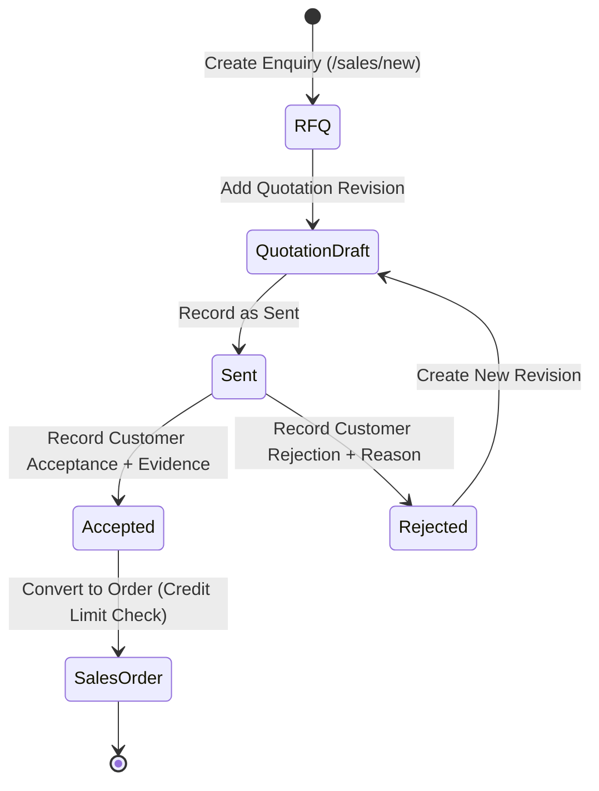
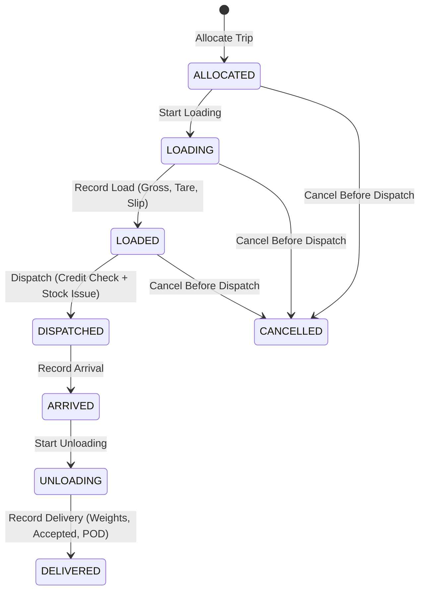
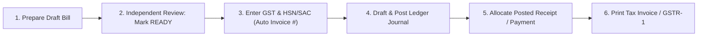
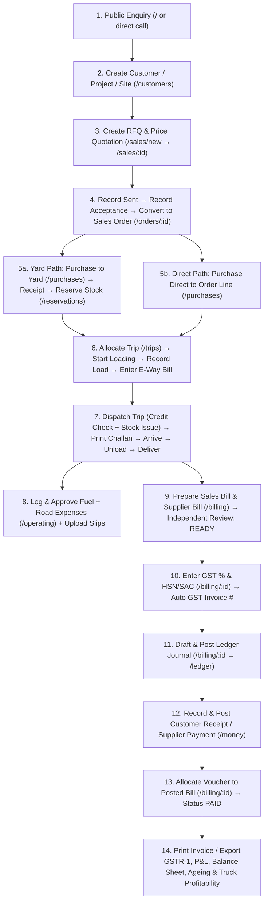

# YFC Transport ERP — Complete User & Operations Guide

> **Application:** YFC Transport & Materials ERP (Public Website, External Partner Portal & Internal Staff Workspace)  
> **Architecture:** Spring Boot 4.1.1 (Java 21) Modular Monolith + PostgreSQL 17 (Flyway V1–V26) + React 19 / Vite 7 / TypeScript SPA  
> **Currency & Units:** Indian Rupees (`INR`, 2 decimals) · Material weights in **Tonnes** (`t`, 3 decimals) · Operational time zone **`Asia/Kolkata` (IST, +05:30)**

---

## Table of Contents

1. [Overview & Core Business Principles](#1-overview--core-business-principles)
2. [Getting Started: Installation & Running Locally](#2-getting-started-installation--running-locally)
3. [URL Map, User Roles & Security Model](#3-url-map-user-roles--security-model)
4. [First-Time Setup Checklist (Administrator)](#4-first-time-setup-checklist-administrator)
5. [Public Website Guide (`/`)](#5-public-website-guide-)
6. [External Partner Onboarding & Portal (`/signup`, `/signin`, `/portal`)](#6-external-partner-onboarding--portal-signup-signin-portal)
7. [Internal Staff ERP Workspace Manual](#7-internal-staff-erp-workspace-manual)
   - [7.1 Navigation, Command Palette & Common UI Controls](#71-navigation-command-palette--common-ui-controls)
   - [7.2 Overview — Operations Command Center (`/dashboard`)](#72-overview--operations-command-center-dashboard)
   - [7.3 Master Data (`/branches`, `/materials`, `/customers`, `/suppliers`)](#73-master-data-branches-materials-customers-suppliers)
   - [7.4 Sales & Orders (`/sales`, `/orders`)](#74-sales--orders-sales-orders)
   - [7.5 Supply, Yards, Purchases & Stock Control (`/yards`, `/purchases`, `/reservations`, `/stock`)](#75-supply-yards-purchases--stock-control-yards-purchases-reservations-stock)
   - [7.6 Fleet & Trip Execution (`/fleet`, `/trips`)](#76-fleet--trip-execution-fleet-trips)
   - [7.7 Fuel & Operating Expenses (`/operating`)](#77-fuel--operating-expenses-operating)
   - [7.8 Finance, GST Billing, Allocations & Reporting (`/ledger`, `/parties`, `/money`, `/billing`)](#78-finance-gst-billing-allocations--reporting-ledger-parties-money-billing)
   - [7.9 Managing the Public Website (`/site`)](#79-managing-the-public-website-site)
   - [7.10 Private Document Attachments](#710-private-document-attachments)
   - [7.11 Administration & Audit (`/people`, `/account-requests`, `/audit`)](#711-administration--audit-people-account-requests-audit)
8. [End-to-End Operational Walkthrough (Order-to-Cash & Procure-to-Pay)](#8-end-to-end-operational-walkthrough-order-to-cash--procure-to-pay)
9. [Troubleshooting, Common Errors & System Boundaries](#9-troubleshooting-common-errors--system-boundaries)

---

## 1. Overview & Core Business Principles

**YFC Transport ERP** is a unified web application built for a bulk construction-material supply and owned-fleet transport business (aggregates, manufactured sand, stone dust, road materials, and tipper logistics). It serves **three distinct audiences** from one single frontend application:

1. **Public Company Website (`/`)** — Anonymous visitors can inspect live ex-plant material rates, calculate indicative landed estimates by plant and destination, browse active loading plants, track desk dispatch tickets, download a company brochure, request callbacks, or submit quotation enquiries.
2. **External Partner Portal (`/portal`)** — Approved **Customers**, **Suppliers**, and **Drivers** sign in to a strictly scoped read-only portal where they view only their own orders, purchases, trips, payment summaries, and printable **GST Tax Invoices / Delivery Challans**.
3. **Internal Staff ERP Workspace (`/staff` → `/dashboard`)** — **Super Admins**, **Operations**, and **Accounts** staff run end-to-end commercial sales, master data, purchasing, yard inventory, owned-fleet compliance, trip execution, fuel/road expense verification, double-entry accounting, multi-state GST billing, invoice payment allocation, financial reporting, public-site management, user management, and audit review.

### Key Business & Control Rules Built Into the Software

| Principle | How YFC ERP Enforces It |
| --- | --- |
| **Ordered-Quantity Customer Billing** | Customer sales bills always bill the agreed **ordered quantity**. Example: `100 t` ordered, `99 t` loaded, `98 t` received still bills `100 t`. Execution weights are tracked separately. |
| **Loaded-Quantity Supplier Billing** | Supplier purchase bills always use the **loaded quantity** recorded on the purchase receipt. |
| **Cost Responsibility Split** | YFC bears **diesel** and **toll** costs (plus driver allowance, parking, tyres, repairs, maintenance). **Loading/unloading** is borne by the customer; **royalty** is borne by the supplier — those categories are excluded from YFC operating expenses. |
| **GST Entered by Accountant per Bill** | Commercial quotations, orders, and purchases store **pre-tax subtotals**. No GST percentage is hard-coded on materials. When a bill reaches `READY`, an accountant enters the Place of Supply (`INTRA_STATE` or `INTER_STATE`), HSN/SAC codes, and GST % for each material and freight line. |
| **Four-Eyes (Maker–Checker) Control** | Financial postings, billing readiness/GST, stock adjustments/transfers/openings/returns, fuel/expense approvals, odometer resets, fuel allocations, weight corrections, and receipt reversals all require an **independent second user**. Even a `SUPER_ADMIN` cannot approve or post their own submission. |
| **Immutability & Audited Reversals** | Posted journals, approved stock movements, and approved fuel/expense entries are never silently edited or deleted. Corrections use explicit reversal workflows, contra journals, or versioned revision histories. |
| **Idempotent Retries** | Forms attach a client-generated UUID (`eventId`, `tripId`, `journalId`, `voucherId`, etc.). Retrying the exact same request safely returns the existing result (`replayed: true`), while reusing a UUID with modified details is rejected with HTTP `409 Conflict`. |
| **No Silent Side Effects** | Operations records (trips, purchases, stock transfers, approved fuel/expenses) **do not automatically post accounting journals**, and money vouchers **do not initiate external bank transfers**. Accountants deliberately convert `READY` bills into journals and record completed cash/bank movements. |

---

## 2. Getting Started: Installation & Running Locally

### 2.1 Prerequisites

- **Java 21+** and **Maven 3.9+** (for the Spring Boot backend)
- **Node.js 20+** and **npm** (for the React + Vite frontend)
- **PostgreSQL 17** — either via local Docker Compose (`backend/compose.yml`), a local PostgreSQL installation, or the configured AWS Aurora PostgreSQL cluster using IAM authentication.

### 2.2 Starting the Backend (`http://127.0.0.1:8080`)

#### Option A — Local PostgreSQL via Docker Compose (Recommended for Local Dev)

Ensure `backend/.env` is configured (see `docs/local-environment.md`), then run from the project root:

```sh
./backend/scripts/db-local.sh
./backend/scripts/run-local.sh
```

- `db-local.sh` starts PostgreSQL 17 and waits until ready.
- `run-local.sh` loads `backend/.env` and runs `mvn spring-boot:run`. Flyway automatically applies migrations `V1` through `V26`.

#### Option B — AWS Aurora PostgreSQL with IAM Authentication

After signing in via AWS CLI (`aws login --region ap-south-2`), run from the project root:

```sh
./backend/scripts/aws-db.sh check
./backend/scripts/run-local.sh backend/.env.aws
```

No static database password is required in IAM mode (`DB_AUTH_MODE=iam`); the backend automatically generates short-lived RDS IAM tokens for each new database connection.

#### Option C — Manual Environment Variables

```sh
cd backend
export SPRING_PROFILES_ACTIVE=local
export DB_URL='jdbc:postgresql://localhost:5432/yfc'
export DB_USER='yfc'
export DB_PASSWORD='your-local-db-password'
export YFC_ADMIN_USERNAME='admin'
export YFC_ADMIN_PASSWORD='choose-a-strong-password-min-12-chars'
mvn spring-boot:run
```

> **First-Run Bootstrap Admin:** On an empty database, `YFC_ADMIN_USERNAME` (default `admin`) and `YFC_ADMIN_PASSWORD` (12–72 UTF-8 bytes) create the initial `SUPER_ADMIN` user. Subsequent restarts preserve existing database users and ignore bootstrap password changes. Remove `YFC_ADMIN_PASSWORD` from runtime config after initialization.

#### Optional Backend Environment Settings

| Variable | Default | Purpose |
| --- | --- | --- |
| `PORT` | `8080` | Backend HTTP port |
| `SESSION_TTL_HOURS` | `12` | Persistent database session lifetime (hours) |
| `DOCUMENTS_STORAGE` | `DATABASE` | Private document blob store: `DATABASE`, `LOCAL`, or `S3` |
| `DOCUMENTS_LOCAL_DIR` | `./data/documents` | Directory used when `DOCUMENTS_STORAGE=LOCAL` |
| `DOCUMENTS_S3_BUCKET` / `DOCUMENTS_S3_REGION` / `DOCUMENTS_S3_PREFIX` / `DOCUMENTS_S3_ENDPOINT` | `""` / `ap-south-2` / `yfc-documents` / `""` | S3 storage configuration when `DOCUMENTS_STORAGE=S3` |
| `RATE_LIMIT_ENABLED` | `true` | Enable per-IP rate limiting on login & public endpoints |
| `RATE_LIMIT_TRUST_PROXY` | `false` | Set `true` behind a trusted reverse proxy to read `X-Forwarded-For` |

### 2.3 Starting the Frontend (`http://127.0.0.1:5173`)

In a second terminal, from the project root:

```sh
cd frontend
npm ci
npm run dev
```

Open **`http://127.0.0.1:5173`** in your browser. Vite automatically proxies `/api`, `/login`, and `/logout` to `http://127.0.0.1:8080` on the same origin so session cookies and CSRF protection work seamlessly.

> **Production Build Note:** Run `npm run build` inside `frontend/` to produce `frontend/dist/`. Serve `dist/` behind Nginx, Caddy, or a CDN/reverse proxy with SPA `index.html` fallback, HTTPS enabled (`SPRING_PROFILES_ACTIVE=prod`), and same-origin proxying for `/api`, `/login`, and `/logout`. Do not use `vite preview` in production.

---

## 3. URL Map, User Roles & Security Model

### 3.1 Application Routes

| URL Path | Audience | Purpose |
| --- | --- | --- |
| `/` | Public | Company homepage, live rates, price estimator, plant directory, order tracker, enquiry form |
| `/signup` (and `/join`) | Public | Self-registration form for Customer, Supplier, or Driver portal accounts (`/join` preselects Supplier) |
| `/signin` | External Partners | Login page exclusively for **Customers, Suppliers, and Drivers** |
| `/portal` | External Partners | Read-only Customer, Supplier, or Driver portal |
| `/staff` | Internal Staff | Login page exclusively for **Super Admin, Operations, and Accounts** staff |
| `/reset` | Any User | Complete an administrator-issued 15-minute password reset using a reset token |
| `/dashboard` | Internal Staff | Staff ERP Overview / Operations Command Center |
| `/sales`, `/sales/new`, `/sales/:id` | Internal Staff | Customer Enquiries (RFQs) & Quotations |
| `/orders`, `/orders/:id` | Internal Staff | Confirmed Sales Orders, Fulfillment & Legacy Dispatches |
| `/customers`, `/materials`, `/suppliers`, `/branches` | Internal Staff | Master Data Catalogues |
| `/yards`, `/purchases`, `/purchases/:id`, `/reservations`, `/stock` | Internal Staff | Supply Chain, Purchasing & Stock Control Queues |
| `/fleet` | Admin & Operations | Trucks, Compliance Profiles, Drivers & Compliance Alerts |
| `/trips`, `/trips/:id` | Internal Staff | Trip Allocation, Execution, E-Way Bills, Incidents, Returns & Challans |
| `/operating` | Internal Staff | Fuel Receipts, Expenses, Fuel Allocations, Odometer Resets & Diesel Rates |
| `/ledger`, `/ledger/:id` | Admin & Accounts | Chart of Accounts, Financial Periods, Journals & Financial Reports |
| `/parties` | Admin & Accounts | Customer/Supplier Financial Profiles, Ledgers, Balances & AR/AP Ageing |
| `/money` | Admin & Accounts | Cash & Bank Books and Money Vouchers |
| `/billing`, `/billing/:id` | Admin & Accounts | Billing Preparation, GST Assessment, Ledger Posting, Allocations & Tax Invoices |
| `/account-requests` | Admin & Operations | Review & approve/disapprove external portal signup requests |
| `/site` | Admin & Operations | Public Website CMS, Live Rates, Freight Matrix & Public Lead Desk |
| `/people`, `/audit` | Super Admin only | User Account Administration, Password Reset Issuance & Audit Trail |

### 3.2 Role-Based Access Control (RBAC) Matrix

Every user has **one role**. Both the React navigation shell and the Spring Security backend (`@PreAuthorize`) enforce permissions.

| Capability / Module | `SUPER_ADMIN` | `OPERATIONS` | `ACCOUNTS` | `CUSTOMER` / `SUPPLIER` / `DRIVER` |
| --- | :---: | :---: | :---: | :---: |
| **Overview (`/dashboard`)** | Full | Ops + Public Desk | Ops + Expense Queue | Redirected to `/portal` |
| **Branches & Materials (`/branches`, `/materials`)** | Read + Write | Read only | Read only | No access |
| **Customers & Projects/Sites (`/customers`)** | Read + Write | Read + Write | Read only | No access |
| **Suppliers, Plants & Plant Materials (`/suppliers`)** | Full (Edit/Status) | Create Supplier/Plant + Link Materials | Read only | No access |
| **Enquiries, Quotations & Orders (`/sales`, `/orders`)** | Read + Write + Credit Override | Read + Write | Read only | No access |
| **Yards, Purchases, Reservations (`/yards`, `/purchases`, `/reservations`)** | Full (incl. Yard Status) | Create/Issue/Close/Return | Read only | No access |
| **Stock Control (`/stock`)** | Submit + Review others' | Submit requests only | Review others' requests | No access |
| **Fleet & Drivers (`/fleet`)** | Read + Write | Read + Write | Hidden (No access) | No access |
| **Trips, E-Way Bills, Incidents, Returns (`/trips`)** | Read + Write + Credit Override | Read + Write | Read + Review Weight Corrections | No access |
| **Fuel, Expenses, Allocations, Odometer (`/operating`)** | Submit + Review others' + Diesel Rates | Submit + Revise + Allocate + Reversal Req | Review others' (Approve/Reject) | No access |
| **Ledger, Chart, Periods, Reports (`/ledger`)** | Full (Setup + Journals + Reports) | No access | Draft/Post Journals + Reports | No access |
| **Party Ledgers, Terms & Ageing (`/parties`)** | Link Parties + Edit Terms + Read | No access | Read Balances, Ledgers & Ageing | No access |
| **Cash & Bank Books & Vouchers (`/money`)** | Register Books + Draft/Post Vouchers | No access | Draft/Post Vouchers | No access |
| **Billing Prep, GST, Allocations (`/billing`)** | Full (Maker–Checker enforced) | No access | Full (Maker–Checker enforced) | No access |
| **Account Requests & Public Site (`/account-requests`, `/site`)** | Full | Full | No access | No access |
| **People & Audit Log (`/people`, `/audit`)** | Full | No access | No access | No access |
| **External Portal (`/portal`)** | No (Staff ERP) | No (Staff ERP) | No (Staff ERP) | Own records only (Read + Print) |

### 3.3 Authentication, Sessions & Security Safeguards

- **Portal-Separated Login:**
  - Internal staff **must** log in at `/staff`. Attempting to use a staff login on `/signin` returns `403 Forbidden` with a prompt to switch to `/staff`.
  - Customers, Suppliers, and Drivers **must** log in at `/signin`. Attempting to use an external login on `/staff` returns `403 Forbidden` with a prompt to switch to `/signin`.
- **Browser-Managed Secure Sessions:** Sessions are stored in the PostgreSQL `persistent_sessions` table (default 12-hour TTL, surviving backend restarts) and managed via `HttpOnly` cookies (`SameSite=Lax`, plus `Secure` in `prod`). No credentials or tokens are ever stored in `localStorage` or `sessionStorage`.
- **CSRF Protection:** Every write operation (`POST`, `PUT`, `PATCH`, `DELETE`) automatically sends the backend CSRF token fetched from `/api/v1/csrf`, refreshing after login and on `403`.
- **Brute-Force Lockout:** **5 failed login attempts** for the same username within **15 minutes** locks that username until the 15-minute window expires. A successful login clears prior failures.
- **Per-IP Rate Limiting (HTTP `429 Too Many Requests`):**
  - `POST /login`: 25 requests / min
  - `POST /api/v1/auth/password-reset`: 10 requests / min
  - Public writes (`account-applications`, `site/enquiries`): 15 requests / min
  - Public reads (`site`, `site/quotes/*`): 120 requests / min
- **Immediate Session Revocation:** Disabling a user, changing their role, or completing a password reset increments their credential version and immediately invalidates all active sessions on their next request.
- **Password Policy:** Minimum **12 characters**, maximum **72 UTF-8 bytes**. Leading/trailing spaces are preserved as part of the password.

---

## 4. First-Time Setup Checklist (Administrator)

When deploying YFC ERP on a fresh database, sign in at **`/staff`** using your bootstrap `SUPER_ADMIN` credentials and set up records in this exact order (because later modules depend on earlier masters):

1. **Create Staff Accounts (`/people`)**
   - Create at least one `OPERATIONS` user and one `ACCOUNTS` user (and ideally a second `ACCOUNTS` user if you want two accountants to review each other's journals/bills without relying on `SUPER_ADMIN`).
2. **Create Branches (`/branches`)**
   - Add each operating office/dispatch hub (e.g., Rajasthan / Haryana).
   - Fill in **Branch GSTIN** (15-char), **GST State Code** (e.g., `08` or `06`, auto-derived from GSTIN — required for CGST Rule 46 multi-state invoice numbering), and **Settlement Bank Details** (Bank Name, Account No., IFSC — printed on Tax Invoices).
3. **Create Material Catalogue (`/materials`)**
   - Add all standard material grades (e.g., `20 MM Aggregate`, `10 MM Aggregate`, `M-Sand`, `Stone Dust`), categories, and optional 4/6/8-digit **HSN codes**.
4. **Configure Accounting Foundations (`/ledger`, `/money`, `/parties`)**
   - **Chart of Accounts (`/ledger` → Chart):** Create active accounts covering:
     - `INCOME` accounts (e.g., Material Sales Income, Freight Income)
     - `EXPENSE` accounts (e.g., Material Purchase Expense)
     - `LIABILITY` accounts for **Output CGST**, **Output SGST**, and **Output IGST** (CGST and SGST must be separate accounts)
     - `ASSET` accounts for **Input CGST**, **Input SGST**, and **Input IGST** (for supplier bills)
     - Fresh `ASSET` accounts for each **Bank** or **Cash** book
     - Fresh dedicated accounts for each **Customer** (`ASSET`) and **Supplier** (`LIABILITY`)
   - **Financial Periods (`/ledger` → Periods):** Create open non-overlapping financial periods (e.g., `FY2627-Q3` or `APR-2026` to `MAR-2027`).
   - **Cash & Bank Books (`/money`):** Register each fresh `ASSET` bank/cash account to its owning Branch.
5. **Set Up Operational Masters**
   - **Yards (`/yards`):** Create `OPERATING` yards (for purchasable/resalable stock) and `QUARANTINE` yards (for damaged/non-resalable returns) per Branch.
   - **Customers (`/customers`):** Add customers, then open each customer to add **Projects** (linked to a Branch) and **Delivery Sites**.
   - **Suppliers (`/suppliers`):** Add suppliers (with GSTIN & address), add their **Loading Plants**, and link catalogue **Materials** to each plant.
   - **Party Financial Profiles (`/parties`):** Link each Customer and Supplier to their fresh dedicated ledger account, set **Payment Terms (days)**, and optionally set a **Customer Credit Limit (INR)**.
   - **Fleet & Drivers (`/fleet`):** Register trucks, immediately complete each truck's **Operating Compliance Profile** (to change it from `INACTIVE` to `ACTIVE`), and register drivers.
   - **Diesel Rates (`/operating` → Diesel rates):** Publish initial pump diesel rates.
6. **Configure Public Website (`/site`)**
   - Update contact phone, WhatsApp number, email, hero/about copy, public material rates, plants, delivery destinations, and the plant-to-destination freight matrix.

---

## 5. Public Website Guide (`/`)

The public homepage is accessible without signing in at **`/`** and displays live data managed from the Staff ERP's **Customer site** screen (`/site`).

### 5.1 Header & Navigation

- **Utility Bar:** Displays company heritage (`Since 2004 · Pan India Delivery`), clickable phone number, and clickable sales email.
- **Primary Navigation:** Smooth-scrolls to **Home**, **Live Rates**, **Materials**, **Services**, **Track Order**, **Plants**, **About Us**, and **Contact**.
- **Action Buttons:** **Login** (`/signin`), **Sign up** (`/signup`), and **Price Estimate** (`#estimator`). Mobile screens show a collapsible drawer menu.

### 5.2 Instant Landed Price Estimator & Live Market Rates (`#estimator`)

1. Select a **Material** (showing ex-plant ₹/tonne).
2. Enter **Quantity (Ton)** (allowed range: `1` to `500` tonnes, up to 3 decimal places).
3. Select **From (Plant Location)** and **To (Delivery Location)** — only destinations with a published positive freight rate from the chosen plant appear.
4. Click **Get Best Estimate** (or change any dropdown) to see:
   - **Ex-Plant Rate** (`₹/t`)
   - **Published Freight** (`₹/t`)
   - **Landed Rate** (`Ex-Plant + Freight`)
   - **Estimated Total** (`excl. GST`)
5. Click **Send Enquiry with Estimate** to automatically scroll to the Request for Quotation form and pre-fill the material, tonnage, route, and indicative price.
6. Below the estimator, **Today's Ex-Plant Market Rates** displays clickable tiles for every active material grade; clicking any tile loads it directly into the estimator.

> **Important:** The estimator produces an **indicative price only** and does **not** create an ERP sales order.

### 5.3 Materials Catalogue & Plant Directory (`#materials`, `#plants`)

- **Materials (`#materials`):** Browse via horizontal carousel (left/right arrows) or click **View All Materials** to switch to a full grid. Clicking any material card selects it in the Price Estimator and scrolls up.
- **Plant Directory (`#plants`):** Filter active crusher yards using **Filter freight by destination** to compare published per-tonne freight across plants. Clicking any plant loads it (and the chosen destination) into the Price Estimator.

### 5.4 Live Dispatch Stage Lookup & Quick Desk Actions (`#track`)

- **Track Your Order:** Enter a YFC dispatch ticket reference (e.g., `YFC-10001-XXXX`) and click **Track Order** to view material, tonnage, route (`Plant → Destination`), and live progress across 4 stages:
  `Confirmed` → `Loading` → `On the Way` → `Delivered`.
- **Talk to Dispatch:**
  - **Chat on WhatsApp:** Opens WhatsApp pre-filled with an enquiry message to YFC's configured WhatsApp number (also available as a floating button at bottom-right).
  - **Request a Call:** Opens a quick callback form (Name + Mobile) that logs a lead on the staff Public Desk and returns a reference number.
  - **Download Brochure:** Instantly downloads `YFC-Transport-Company-Brochure.txt` populated with live published rates, plants, services, and contact details.

### 5.5 Request for Quotation Form (`#contact`)

Enter **Your Name / Company**, **Mobile Number**, and **Material, Tonnes & Delivery Site Details**, then click **Submit Enquiry to Desk**. The visitor receives an enquiry reference code immediately, and the enquiry appears in the Staff ERP under **Administration → Customer site → Enquiries**.

---

## 6. External Partner Onboarding & Portal (`/signup`, `/signin`, `/portal`)

### 6.1 Submitting an Account Application (`/signup`)

External partners self-register at `/signup` (or `/join` for Suppliers) by selecting one of three tabs:

| Role Tab | Required Fields | Optional Fields |
| --- | --- | --- |
| **Customer** | Name/Company, Mobile, Username (3–80 chars), Password (12–72 chars) | Delivery Address, GSTIN (15-char) |
| **Supplier** | Company/Crusher Name, Mobile, **GSTIN**, **Plant/Billing Address**, Username, Password | Business Email |
| **Driver** | Full Name, Mobile, **Driving Licence Number**, **Licence Expiry Date**, **Emergency Contact Name**, **Emergency Mobile**, Username, Password | — |

After submission, the request waits in the staff review queue. Duplicate usernames, or GSTINs / licence numbers that already have an active portal login or pending application, are automatically rejected.

### 6.2 Staff Approval Workflow (`/account-requests`)

`SUPER_ADMIN` and `OPERATIONS` users open **Administration → Account requests** (also highlighted in an alert banner on `/dashboard`):

- **To Approve:**
  1. Click **Approve** on the pending card.
  2. **Link to existing record (optional):** Choose an existing Customer, Supplier, or Driver from the dropdown if they already exist in ERP masters, **or leave blank** to automatically create a new master record from their application.
  3. **Driver's branch:** If approving a *new* Driver without linking an existing one, select the active **Branch** they belong to.
  4. Enter a **Reason** and click **Approve account**.
  5. Approval atomically creates/links the master record, creates the login account, and binds `account_ownership`. No automated email/SMS is sent — notify the partner through your normal channel that their chosen username and password are now active.
- **To Disapprove:**
  1. Click **Disapprove**, enter a **Reason**, and click **Disapprove account**.
  2. Disapproval frees the requested username so the person can reapply if needed.

### 6.3 Using the External Portal (`/signin` → `/portal`)

Once approved, Customers, Suppliers, and Drivers sign in at **`/signin`** and land on **`/portal`**. Every query is strictly scoped to their own linked record (up to the latest 50 rows per table):

- **Customer View:**
  - **KPI Summary Strip:** Total Invoiced, Paid / Settled, Outstanding Balance, and Dispatched Trips.
  - **Your Details:** Name, mobile, GSTIN, and address.
  - **Orders:** Order ID, Material, Ordered Quantity (`t`).
  - **Trips & Delivery Challans:** Trip ID, Material, Truck, E-Way Bill, Status, Planned Date, and a **Challan / Print** button opening a printable **Delivery Challan** (with `Print Delivery Challan` → browser print / save PDF).
  - **Bills & Tax Invoices (`READY` bills only):** Invoice Number, Date, Status, Amount, Paid, Outstanding, and an **Invoice / Print** button opening a printable **GST Tax Invoice** (with HSN/SAC tax breakdown, branch GSTIN, settlement bank details, and INR amount in words).
- **Supplier View:**
  - **KPI Summary Strip:** Total Billed, Paid / Settled, Outstanding Balance, Total Bills.
  - **Your Details**, **Plants**, **Purchases** (Purchase ID, Material, Status, Quantity), and **Bills & Tax Invoices** (with **Invoice / Print**).
- **Driver View:**
  - **Your Details** (including licence number, expiry, and assigned branch).
  - **Trips & Delivery Challans** (strictly trips assigned to this driver, with **Challan / Print**).

---

## 7. Internal Staff ERP Workspace Manual

### 7.1 Navigation, Command Palette & Common UI Controls

- **Left Sidebar:** Organized into 7 sections — **Workspace**, **Sales**, **Masters**, **Supply**, **Movement**, **Finance**, and **Administration**. Only sections permitted for your role are shown. Your username, role badge, and **Sign out** button appear at the bottom-left.
- **Quick Navigation Command Palette (`⌘K` on macOS / `Ctrl+K` on Windows & Linux):**
  - Click **Jump to…** in the sidebar or press `⌘K` / `Ctrl+K` anywhere in the Staff ERP.
  - Type a module name, screen name, or route (e.g., `billing`, `trips`, `new customer enquiry`).
  - Use `↑` / `↓` arrows and press `Enter` to jump immediately; press `Esc` to close.
- **Header Bar:** Shows breadcrumb navigation (`YFC ERP › <Current Section>`) and today's date in IST (`Asia/Kolkata`).
- **Search & Filter Bars:** Available on **Customers**, **Orders**, **Purchases**, **Trips**, and **Billing Prep** with debounced server-side search and a **Clear filters** reset button.
- **Pagination:** Lists display 20 rows per page with **Previous** / **Next** controls. Dropdown selectors automatically fetch all pages in the background.
- **CSV Export:** Available on **Trips**, **Billing Prep**, **Trial Balance**, **Profit & Loss**, **Balance Sheet**, **GSTR-1 Invoices**, **GSTR-1 HSN Summary**, **Truck Profitability**, and **AR/AP Ageing**.
- **Maker–Checker Review Box:** Whenever a record is pending review and you are signed in as the **same user** who submitted it, the UI displays *"A different user has to review this request."* Sign in as a different eligible reviewer to see **Approve / Reject** (or **Post / Reject** / **Mark ready**).

---

### 7.2 Overview — Operations Command Center (`/dashboard`)

The landing screen for all internal staff provides a real-time operational snapshot:

- **Top Action Bar:** **Refresh** button (refetches all dashboard queries), **+ New enquiry** (for Admin/Operations), and **Dispatch workspace** (or **View sales orders** for Accounts).
- **Priority Alert Strip (Admin & Operations):**
  - Pending external **account requests** awaiting approval → links directly to `/account-requests`.
  - Waiting **public desk leads** (website enquiries + undelivered desk quotes) → links directly to `/site`.
- **4 KPI Cards:**
  1. **Sales orders** (total confirmed orders)
  2. **Customer enquiries** (total RFQs)
  3. **Active trips in view** (non-delivered, non-cancelled trips within the latest 100 trips)
  4. **Compliance alerts in view** (for Admin/Operations: trucks due within 30 days) **or** **Expenses awaiting review** (for Accounts: pending expenses within the latest 100)
- **Trip Movement Pipeline:** Displays live counts across **Allocated → Loading → On the road → Delivered** (from the latest 100 trips), followed by the 6 most recent trips with direct links to each trip detail page.
- **Attention & Approvals Panel:** Quick links to **Vehicle compliance** (`/fleet`), **Expense approvals** (`/operating`), and **Stock control** (`/stock`).
- **Quick Access Grid:** One-click links to Customers, Materials, Purchases, and Orders.

---

### 7.3 Master Data (`/branches`, `/materials`, `/customers`, `/suppliers`)

#### Branches (`/branches`) — *Admin write, Ops/Accounts read*
- Click **+ New branch** to create a branch with:
  - **Code** (2–30 alphanumeric/`_`/`-`), **Name**, **Address**, **City**, **State**, **PIN code** (6 digits, not starting with 0).
  - **Branch GSTIN** (15-char Indian GSTIN, optional — auto-uppercased).
  - **GST State Code** (2-digit, e.g. `08` for Rajasthan, `06` for Haryana — auto-extracted from GSTIN if provided; powers multi-state invoice numbering and intra/inter-state GST suggestion).
  - **Settlement Bank Name**, **Bank Account No.**, and **IFSC Code** (optional — displayed on printable Tax Invoices).
- Click **Open** on any branch row to edit details or toggle **Active / Inactive**.

#### Materials (`/materials`) — *Admin write, Ops/Accounts read*
- Click **+ New material** to add a catalogue material with **Code**, **Name**, **Category** (`AGGREGATES`, `SAND`, `DUST`, `ROAD_MATERIALS`, `OTHER`), and optional **HSN code** (4, 6, or 8 digits).
- Click **Open** on any row to update or activate/deactivate. Catalogue edits never overwrite historical snapshots on already-created orders or purchases.

#### Customers (`/customers`) — *Admin & Ops write, Accounts read*
- Use the search bar to filter by **name, mobile, or GSTIN**.
- Click **+ New customer** to enter **Customer name**, **Mobile**, and optional **GSTIN**.
- Click **Open** on any customer to manage their hierarchy:
  - **Create a project:** Select an active **Branch**, **Code**, **Name**, and optional **Description**.
  - **Add a delivery site:** Select a Project from the dropdown, then expand **Add a delivery site** to enter **Code**, **Name**, **Address**, optional **Contact name**, and optional **Mobile**.
  - Expand **Update site** on any existing site to edit details or toggle **Active / Inactive**.

#### Suppliers (`/suppliers`) — *Admin full write, Ops create & link, Accounts read*
- Click **+ New supplier** to enter **Code**, **Name**, **GSTIN** (required), **Mobile**, optional **Email**, and **Address**.
- Click **Open** on a supplier to:
  - Edit supplier details or toggle status (*Admin only*).
  - **Add a New plant:** Enter **Code**, **Name**, **Address**, optional **Contact** and **Mobile**.
  - **Link / Remove catalogue materials** on each plant (a purchase order can only buy materials linked to that plant) and toggle each plant's Active/Inactive status.

---

### 7.4 Sales & Orders (`/sales`, `/orders`)



#### Step 1: Create a Customer Enquiry / RFQ (`/sales` → `+ New enquiry`)
1. **Customer & Delivery:** Choose **Customer** → active **Project** → active **Delivery site**, set **Required date** (today or future), and choose **Business type**:
   - `MATERIAL_AND_TRANSPORT` (both material and freight rates quoted)
   - `MATERIAL` (material only; transport rate locked at `0`)
   - `TRANSPORT` (transport only; material rate locked at `0`, does not consume YFC yard stock)
2. **Material Requirements:** Add 1 to 100 unique active materials with quantities in tonnes (`step 0.001`). Click **+ Add material** for multi-line orders.
3. Add optional **Remarks** and click **Create enquiry**. Requirements are saved as an immutable snapshot.

#### Step 2: Price & Manage Quotation Revisions (`/sales/:id`)
1. Click **+ New revision** on the enquiry detail page.
2. Enter **Valid until** date (today or future), **Material ₹/tonne** and/or **Transport ₹/tonne** per line, **Payment terms**, and **Delivery terms** (defaults to *"Customer pays loading/unloading; supplier pays royalty."*).
3. Click **Save quotation revision**. Server computes pre-tax line and quotation subtotals.
4. Click **Record as sent** on the latest `DRAFT` revision.
   > **Note:** *"Record as sent"* logs that staff sent the quotation externally (via email, WhatsApp, or print); the system does **not** automatically send a message to the customer.
5. While `SENT` and not expired, record the customer's response:
   - **Record acceptance:** Enter **Customer contact**, **Customer PO / email / call reference**, and optional **Note**.
   - **Record rejection:** Enter **Customer contact**, **Reference**, and mandatory **Reason**. You may then create a new quotation revision.

#### Step 3: Convert Accepted Quotation to Sales Order
1. On an `ACCEPTED` quotation, click **Convert to order**.
2. **Customer Credit Limit Guard:** If the customer has a Credit Limit set in **Party Ledgers** (`/parties`), the backend checks:  
   `Current Posted Receivable + New Order Subtotal ≤ Credit Limit`.
   - If exceeded, conversion is blocked with a `409 Conflict` error.
   - Collect and post a customer receipt first, **or** if you are a `SUPER_ADMIN`, click the **Override credit limit & convert (Super Admin)** button that appears — the override is recorded in the Audit Trail.
3. Upon conversion, you are redirected to `/orders/:id`.

#### Manual Orders & Order Details (`/orders`, `/orders/:id`)
- **Filter/Search Orders:** Search by material or delivery site, and filter by **Branch** or **Order type**.
- **Manual Order (`+ Manual order`):** For direct orders that did not originate from an RFQ. Fill Customer, Business type, Material description, Delivery site, Ordered tonnes, Material/Transport rates, and optional Branch / Saved material. *(Note: To allocate trips or prepare bills later, an order must have a saved Branch — and material orders need a saved Material.)*
- **Order Detail (`/orders/:id`):**
  - Displays **Billable Quantity (= Ordered)**, **Subtotal excluding GST**, **Loaded**, and **Received** quantities per line.
  - Shows a **Sourcing / Fulfillment** panel for every line item.
  - **Record a legacy weighbridge weight:** Only for legacy orders **not** using the trip workflow. Any order line that already has trips rejects legacy weighbridge entries.

---

### 7.5 Supply, Yards, Purchases & Stock Control (`/yards`, `/purchases`, `/reservations`, `/stock`)

#### Yards (`/yards`)
- Click **+ New yard** (*Admin/Ops*) to create a yard under a Branch with Code, Name, Address, and **Kind**:
  - **`OPERATING`**: Holds sellable inventory. Used for purchases, stock reservations, trip issues, transfers, counts, openings, and resalable customer returns.
  - **`QUARANTINE`**: Holds damaged/rejected/non-resalable material. **Cannot** be used for purchases, reservations, or trip issues.
  - **Kind is permanent** and cannot be changed after creation.
- Click **Open** on any yard to inspect **Stock balance** (select any material to view `on_hand`, `reserved`, `available`, and the full **Movements** ledger) and toggle yard Active/Inactive status (*Admin only*).

#### Purchases (`/purchases`, `/purchases/:id`)
- Search by material/supplier/plant, and filter by **Status** (`OPEN`, `RECEIVED`, `CLOSED`, `CANCELLED`) or **Branch**.
- Click **+ New purchase** (*Admin/Ops*) to issue a single-material purchase commitment:
  - Select **Supplier** → active **Plant** → **Material** (must be linked to that plant).
  - Choose **Destination**:
    - **`YARD`**: Choose an `OPERATING` yard. Accepted receipts increase yard stock.
    - **`DIRECT`**: Choose a specific **Sales order line**. Material goes directly from supplier plant to customer via a Direct trip and never enters YFC yard stock.
  - Enter **Quantity (tonnes)**, **Rate ₹/tonne**, **Expected date**, and **Terms**.
- **Open a Purchase (`/purchases/:id`):**
  - **Record a receipt** (while `OPEN`): Enter **Received date**, **Loaded tonnes**, **Received tonnes**, **Accepted tonnes**, **Challan / weighbridge reference**, and **Discrepancy reason** (mandatory whenever loaded ≠ received ≠ accepted).
  - **Close the remaining balance:** Permanently closes any undelivered portion of an `OPEN` PO with a reason.
  - **Request reversal of a receipt:** Available on standalone purchase receipts (*not* trip-linked direct delivery receipts — those are corrected via Delivered Weight Corrections on the trip). Goes to **Stock Control → Receipt reversals** for Accounts approval.
  - **Return accepted material to the supplier** (`YARD` purchases only): Submit quantity, date, reason, and evidence reference. Goes to **Stock Control → Supplier returns** for Accounts approval.

#### Stock Reservations (`/reservations`)
- Click **+ Reserve stock** (*Admin/Ops*) to lock available stock in an `OPERATING` yard for a specific **Sales order line**.
- Reserving increases `reserved` stock (reducing `available` stock) without reducing `on_hand`.
- Click **Open** on a reservation to:
  - **Issue reserved stock** (manual gate/dispatch issue — reduces both `on_hand` and `reserved`).
  - **Release the unissued balance** (returns unused reserved tonnage to available stock with a reason).
  - *(Note: When fulfilling through the Trip workflow, dispatching a `YARD` trip automatically issues the loaded weight from the reservation.)*

#### Stock Control (`/stock`) — *Maker–Checker Queues*
All stock corrections follow strict two-person review: **Operations/Admin submits (`PENDING`) → a different Accounts/Admin user approves or rejects**. Stock changes **only upon approval**.

| Tab | Purpose | Key Rules |
| --- | --- | --- |
| **Counts** | Physical inventory `INCREASE` or `DECREASE` | Requires `Expected on-hand tonnes` (optimistic lock — approval fails with `409` if stock moved in the meantime). Cannot drop on-hand below reserved stock. Approved counts/returns can also be **reversed** from the detail panel. Supports private file uploads (`STOCK_ADJUSTMENT`). |
| **Opening stock** | Initial physical tonnage in a yard | Allowed **only when current on-hand is `0`**. Quantity-only (no accounting journal). Supports private file uploads (`STOCK_OPENING`). |
| **Transfers** | Move stock between two yards | `OPERATING → OPERATING` may cross branches (no journal posted). Any transfer involving a `QUARANTINE` yard **must stay within the same branch**. Supports private file uploads (`STOCK_TRANSFER`). |
| **Reversals** | Approve/reject reversals of approved Counts or Customer Returns | Reverses stock impact (or return capacity only for non-resalable returns to operating yards). |
| **Receipt reversals** | Approve/reject reversals of standalone Purchase Receipts | Reverses yard stock addition and reopens PO balance if applicable. |
| **Supplier returns** | Approve/reject returns of accepted Yard Purchase stock back to Supplier | Reduces yard on-hand stock upon approval. |

A **Stock balance** lookup widget sits at the bottom of `/stock` so reviewers can verify current balances and movements before approving.

---

### 7.6 Fleet & Trip Execution (`/fleet`, `/trips`)

#### Fleet Management (`/fleet`) — *Admin & Operations only*

1. **Trucks Tab:**
   - **Register a truck:** Enter **Registration** (e.g., `HR55AB1234`), **Capacity (tonnes)**, **Tank capacity (litres)**, and **Mileage (km/litre)**.
   - Every new truck starts **`INACTIVE`**. Click **Open** on the truck row and fill out **Operating profile**:
     - **Branch**, **Owner**, **Truck type**, **RC reference**, **Insurance reference**, and expiry dates for **Insurance**, **Fitness**, **Permit**, and **Pollution**, then set **Status** to `ACTIVE` (`INACTIVE` or `MAINTENANCE` also supported).
2. **Drivers Tab:**
   - **Register a driver:** Enter **Branch**, **Name**, **Mobile**, **Licence number** (unique, auto-uppercased), **Licence expiry**, **Emergency contact**, **Emergency mobile**, and **Active** status.
   - Use **Update a driver** at the bottom to select and edit an existing driver. *(A truck's or driver's branch cannot be changed while assigned to an active trip.)*
3. **Compliance Tab:**
   - Set **Window in days** (`0` to `365`, default `30`) to list trucks with missing/expired/soon-expiring documents and drivers with expiring licences. *(Informational listing; no automated SMS/email alerts are sent.)*

#### Trips List (`/trips`)
- Displays an **E-Way Bill expiry alert banner** whenever active trips have E-Way Bills expired or expiring within 24 hours.
- Search by **truck, driver, or E-Way Bill**, filter by **Status**, **Source** (`YARD`, `DIRECT`, `TRANSPORT`), or **Branch**, and export via **Export CSV**.

#### Allocating a Trip (`/trips` → `+ Allocate trip`)
- One trip carries **one order line** using **one truck** and **one driver** (each truck and driver can have at most **one active trip** at a time).
- Truck, driver, and sales order **must share the same active branch**.
- Select **Order line**, **Truck**, **Driver**, and **Source**:
  - **`YARD`**: Pick an active **Stock reservation** for that order line.
  - **`DIRECT`**: Pick an `OPEN` **Direct purchase** for that order line.
  - **`TRANSPORT`**: For transport-only orders (no yard stock involved).
- Enter **Planned tonnes** (must fit truck capacity and unclaimed source quantity), **Planned date**, and **Distance (km)** (used to compute planning `estimated_fuel_litres = distanceKm / mileage`, rounded up to 3 decimals).

#### Trip Lifecycle Execution (`/trips/:id`)



1. **Start loading (`ALLOCATED → LOADING`):** Allowed on or after the planned date; rechecks truck/driver compliance.
2. **Record load (`LOADING → LOADED`):** Enter **Gross tonnes**, **Tare tonnes** (net = `gross − tare`, must not exceed planned quantity), and **Slip reference**. Does not issue yard stock yet.
3. **Record E-Way Bill (anytime before cancellation):** Fill the **E-Way Bill** card with the **12-digit E-Way Bill Number** and **Valid Until (IST)** — printed on the Delivery Challan and tracked by the 24-hour expiry alert.
4. **Dispatch (`LOADED → DISPATCHED`):**
   - Rechecks truck/driver compliance and **Customer Credit Limit** (a `SUPER_ADMIN` can tick **Override customer credit limit** if needed — audited).
   - For `YARD` trips: issues the actual loaded weight from the reservation (reducing `on_hand` and `reserved`) and releases unused planned reservation capacity.
   - For `DIRECT` trips: holds the actual loaded weight against the direct PO until delivery.
5. **Record arrival (`DISPATCHED → ARRIVED`)** & **Start unloading (`ARRIVED → UNLOADING`)**: One-click progression (allowed even if a truck enters maintenance after dispatch, so real-world completion can always be recorded).
6. **Record delivery (`UNLOADING → DELIVERED`):** Enter **Gross tonnes**, **Tare tonnes**, **Slip reference**, **Accepted tonnes** (`0 ≤ accepted ≤ received ≤ loaded`), **Receiver**, **Proof reference**, and **Discrepancy reason** (required if loaded ≠ received ≠ accepted).

#### Printable Challan, Mid-Trip Actions & Post-Delivery Corrections (`/trips/:id`)
- **Print Delivery Challan:** Click **Print Delivery Challan** at the top of the trip page to print or save a PDF challan showing Branch GSTIN, Consignee, Material, E-Way Bill, Planned/Loaded/Received weights, Truck/Driver, and signature blocks.
- **Approved Operating Cost:** Automatically displays the sum of approved fuel, fuel allocations, and road expenses linked to the trip.
- **Cancel before dispatch:** Available in `ALLOCATED`, `LOADING`, or `LOADED` with a mandatory reason.
- **Change the crew (Crew Reassignment):** Available in `DISPATCHED`, `ARRIVED`, or `UNLOADING` if a truck breaks down or driver swaps mid-route. Replacement truck/driver must be free, compliant, same branch, and have sufficient capacity.
- **Private Documents:** Upload PDF/JPEG/PNG files (weighbridge slips, PODs, photos) directly to the Trip (`TRIP`).
- **Incidents:** Report an incident (`BREAKDOWN`, `ACCIDENT`, `DELAY`, `SHORTAGE`, `DAMAGE`, `OTHER`) with IST timestamp, description, and evidence reference. Upload photos/PDFs to each incident (`INCIDENT`) and click **Resolve** once closed. Incidents never mutate weights, stock, or billing.
- **Delivered Weight Corrections (`DELIVERED` trips):** Submit corrected Loaded Gross/Tare, Received Gross/Tare, Accepted Tonnes, Reason, and Evidence Reference. Share the returned **Correction ID** with an **Accounts** user (or paste it into **Review a weight correction** on the same screen) for independent approval. Approval updates trip/dispatch weights without changing ordered-quantity customer billing.
- **Customer Return into a Yard (`DELIVERED` material trips):**
  - Select a **Receiving yard** (must belong to the order's branch), **Quantity** (capped at `accepted delivered weight − prior pending/approved returns`), **Received on**, **Resalable** (`Suitable for resale` vs `Not resalable`), **Reason**, and **Evidence reference**.
  - Routes to **Stock Control → Counts** for independent Accounts approval:
    - **Resalable = Yes** → must be an `OPERATING` yard → approval **increases on-hand stock**.
    - **Resalable = No + `OPERATING` yard** → approval consumes return capacity only (on-hand unchanged).
    - **Resalable = No + `QUARANTINE` yard** → approval **increases quarantine yard on-hand stock** so held material stays visible.

---

### 7.7 Fuel & Operating Expenses (`/operating`)

Operational road costs are verified independently (**Admin/Ops submits → a different Admin/Accounts user approves/rejects**). Approved costs appear on **Trip Operating Costs** and the **Truck Profitability** report, but do **not** auto-post to the general ledger.

#### Tab 1: Fuel (`/operating` → Fuel)
1. Click **+ Fuel receipt** to record a pump fill:
   - Select **Truck**, **Diesel rate** (must be effective on/before fill date), optional **Trip** (omit for truck-only fills that may be split later), **Receipt reference** (globally unique — include pump prefix), **Filled on** (date), **Litres** (cannot exceed truck tank capacity), **Actual ₹/litre**, **Odometer**, **Filled at (IST)** (must match `Filled on` date), **Receipt evidence**, and **Price variance reason** (mandatory if actual price differs from the selected master diesel rate).
2. Click **Open** on any fuel entry to:
   - **Approve / Reject** (independent reviewer): Approval enforces **strict chronological odometer ordering** across all approved fills for that truck (cannot be below an earlier approved reading or above a later approved reading, unless an approved Odometer Reset sits between them).
   - **Revise:** Available while `PENDING_VERIFICATION` or `REJECTED`. Stores the previous version in history and increments revision.
   - **Allocate this receipt to a trip:** Available on an `APPROVED`, non-reversed **truck-only** receipt (no trip assigned at creation). Select a matching-truck **Trip** whose window includes the fill timestamp, enter **Litres**, **Reason**, and **Evidence**. Routes to **Fuel allocations** tab for independent approval.
   - **Request reversal:** Available on `APPROVED` receipts (any pending fuel allocations must be rejected first). Paste the returned **Reversal ID** into **Review an operating reversal** (on the Diesel rates tab) for a second user to approve/reject.
   - **Private documents:** Upload pump receipt scans/photos (`FUEL`).

#### Tab 2: Expenses (`/operating` → Expenses)
- Click **+ Expense** to submit an operational road expense:
  - Allowed categories: `TOLL`, `DRIVER_ALLOWANCE`, `PARKING`, `TYRE`, `MAINTENANCE`, `REPAIR`, `OTHER`.
  - **`TOLL`, `DRIVER_ALLOWANCE`, and `PARKING` require a Trip.**
  - Loading, unloading, royalty, and diesel are intentionally excluded.
- Click **Open** on any row to **Approve / Reject**, **Revise** (when pending/rejected), **Request reversal** (when approved), or attach **Private documents** (`EXPENSE`).

#### Tab 3: Fuel Allocations (`/operating` → Fuel allocations)
- Lists pending/reviewed splits of truck-only fuel receipts across trips. Reviewers open any `PENDING` row to **Approve** or **Reject** (server calculates `litres × receipt price`, HALF_UP).

#### Tab 4: Odometer Resets (`/operating` → Odometer resets)
- Use when a truck's odometer rolls over or its instrument cluster is replaced.
- Submit **Truck**, **New reading**, **Reset at (IST, not in future)**, **Reason**, and **Evidence reference** (max 1 pending reset per truck).
- Once independently approved, subsequent fuel fills after `resetAt` are permitted to have readings lower than pre-reset fills.

#### Tab 5: Diesel Rates (`/operating` → Diesel rates)
- **Publish a diesel rate** (*Super Admin*): Enter **Pump**, **Location**, **Effective date**, and **Price ₹/litre**.
- **Correct a published price** (*Super Admin*): Open a rate and submit **Expected current price** (optimistic lock), **New price**, and **Reason**. Historical fuel receipts retain the rate snapshotted when they were submitted.
- **Review an operating reversal** (*Accounts/Admin*): Paste a Fuel or Expense **Reversal ID** to independently **Approve** or **Reject** the reversal.

---

### 7.8 Finance, GST Billing, Allocations & Reporting (`/ledger`, `/parties`, `/money`, `/billing`)

*Accessible exclusively to **`SUPER_ADMIN`** and **`ACCOUNTS`**.*

#### 7.8.1 General Ledger (`/ledger`)

- **Chart Tab (`Accounts`):**
  - *Super Admin* creates accounts with **Code**, **Name**, and **Type** (`ASSET`, `LIABILITY`, `EQUITY`, `INCOME`, `EXPENSE`). No opening balance is invented.
  - Open any account to activate/deactivate it (requires **Expected current state** + **Reason**).
- **Periods Tab:**
  - *Super Admin* creates non-overlapping financial periods (**Code**, **Starts**, **Ends**).
  - Open an ended period to **Close period** (blocked if any `DRAFT` journals remain in that period). Closing locks the period against further posting.
- **Journals Tab (`/ledger`, `/ledger/:id`):**
  - Click **+ Journal draft** to create a balanced multi-line manual journal (**Period**, **Branch**, **Entry date**, **Reference**, **Description**, and 2+ lines where `Total Debit = Total Credit`).
  - Open a draft journal (`/ledger/:id`) as a **different user** to **Post** (assigns sequential journal number) or **Reject**.
  - On any `POSTED` journal, submit a **Contra reversal** into an open period (creates a reversing journal draft that a second user posts).
- **Reports Tab (`/ledger` → Reports):**
  All reports support date filters, optional **Branch filter** (or consolidated across all branches), and **Export CSV**:
  1. **Trial Balance & Ledger:** As-of Trial Balance + interactive **Account Ledger** showing opening balance, chronological debit/credit rows, running balance, and closing balance.
  2. **Profit & Loss:** Date-range summary of posted `INCOME` vs `EXPENSE` accounts and **Net Profit / (Loss)**.
  3. **Balance Sheet:** As-of **Assets**, **Liabilities**, and **Equity + Retained Earnings** with an automated `Balanced` / `Out of balance` verification check.
  4. **GSTR-1 & HSN:** Date-range outward sales register of all `READY` sales bills with an assigned GST Invoice Number. Automatically classifies invoices as **B2B** (customer has GSTIN) or **B2C**, displays CGST/SGST/IGST totals, aggregates an **HSN/SAC Summary** table, and exports two filing-ready CSVs (**Export Invoices CSV** and **Export HSN CSV**).
  5. **Truck Profitability:** Date-range fleet utilization & cost report per truck — Completed Trips, Tonnes Delivered, Total Km, Approved Fuel (L & ₹), Approved Road Expenses (₹), Total Operating Cost, **₹ / Tonne**, and **₹ / Km**.

#### 7.8.2 Party Ledgers & AR/AP Ageing (`/parties`)

- **Link a Party (*Super Admin*):** Permanently bind a **Customer** or **Supplier** to a fresh unused chart account (`ASSET` for Customer, `LIABILITY` for Supplier), setting **Payment terms (0–365 days)** and optional **Credit limit (INR)** for Customers.
- **Change Terms (*Super Admin*):** Open a party profile to update payment terms or credit limit with optimistic **Current version** and **Reason**.
- **Party Ledger:** Open any linked party and select a date range to view their detailed posted ledger.
- **Posted Balances:** Choose an **As of** date to view net receivable/payable balances across all linked parties.
- **AR / AP Ageing Report:** Choose an **As of date** and optional **Party filter** (`All`, `Customers (AR)`, `Suppliers (AP)`) to group unpaid posted bills past their payment terms into **Current**, **1–30d**, **31–60d**, **61–90d**, and **90+d** buckets, complete with summary KPIs and **Export CSV**.

#### 7.8.3 Cash & Bank Books and Money Vouchers (`/money`)

- **Register a Cash or Bank Book (*Super Admin*):** Bind a fresh active `ASSET` chart account permanently to a **Branch** as **`BANK`** or **`CASH`** with a designation reference. All journals touching that account must use its owning branch.
- **Record a Money Voucher:** Records cash/bank funds that have already moved externally (does **not** execute a bank transfer):

| Voucher Kind | Party Type | Accounting Entry (on Post) | Special Safeguards |
| --- | --- | --- | --- |
| `CUSTOMER_RECEIPT` | Customer | Debit Cash/Bank · Credit Customer | Can create customer advance; allocatable to sales invoices |
| `SUPPLIER_PAYMENT` | Supplier | Debit Supplier · Credit Cash/Bank | Can create supplier advance; allocatable to supplier bills |
| `CUSTOMER_REFUND` | Customer | Debit Customer · Credit Cash/Bank | Capped at posted customer credit balance in that branch |
| `SUPPLIER_REFUND` | Supplier | Debit Cash/Bank · Credit Supplier | Capped at posted supplier debit/advance balance in that branch |

- **Cash-Book Safeguard:** Every posted entry on a registered `CASH` account must leave **every daily closing cash balance ≥ ₹0.00** (including backdated entries). `BANK` books permit negative balances.
- **Duplicate-Reference Protection:** Voucher **Unique reference** is unique per money account while `DRAFT` or `POSTED` (released if rejected).
- **Review:** Open a `DRAFT` voucher as a **different user** to **Post** or **Reject**.

#### 7.8.4 Billing Preparation, Multi-State GST & Payment Allocations (`/billing`, `/billing/:id`)



1. **Prepare a Bill (`/billing`):**
   - Select **Kind**:
     - **`SALES_ORDER`**: Select a confirmed sales order (basis locked to `ORDERED` — one bill covers the entire order).
     - **`PURCHASE_RECEIPT`**: Select a supplier purchase receipt (basis locked to `LOADED`).
   - Enter **Prepared on** (not before source date, not future), **Reference**, **Evidence reference**, and **Why this quantity basis**.
   - Each source order or receipt can have only **one active billing preparation** at a time.
2. **Independent Review (`/billing/:id`):**
   - A **different user** opens the `DRAFT` preparation and clicks **Mark ready** (or **Reject** / **Cancel** with a reason).
3. **Enter GST on the `READY` Bill:**
   - A **different user** (from the bill creator) sees the **Enter GST on this bill** form while GST is editable (i.e., before a linked journal is drafted/posted).
   - **Place of supply** is auto-suggested by comparing the Branch GST State Code with the Party GSTIN State Code:
     - `INTRA_STATE` → Tax splits 50/50 into **CGST + SGST**.
     - `INTER_STATE` → Tax posts 100% as **IGST**.
   - Enter the **HSN or SAC** (4–8 digits) and **GST %** for every positive material and freight component, then click **Save GST on this bill**.
   - **Automatic Multi-State Sales Invoice Numbering (CGST Rule 46 compliant, ≤ 16 chars):**
     - If the branch has a 2-digit GST State Code: **`SI-<FY>-<STATE>-<00001>`** (e.g., `SI-2627-08-00001` for Rajasthan FY 2026–27).
     - If no branch state code is set: **`SI-<FY>-<00001>`**.
   - GST can still be corrected by a different user until a ledger journal is drafted/posted.
4. **Draft & Post the Ledger Journal:**
   - Once `tax_treatment = ASSESSED`, fill **Draft the ledger journal**: select an open **Period**, active **Income** (for sales) or **Expense** (for supplier) counter account, required **CGST & SGST** or **IGST** accounts (`LIABILITY` for sales output GST; `ASSET` for purchase input GST), **Entry date**, **Reference**, and **Description**.
   - Open the created draft journal under `/ledger` as a **different user** and click **Post**.
5. **Allocate Posted Receipts / Payments (Settlement):**
   - Once the bill's journal is `POSTED`, the **Payment allocations** section appears on `/billing/:id`.
   - Select a `POSTED` money voucher for the **same party** (`CUSTOMER_RECEIPT` for sales invoices; `SUPPLIER_PAYMENT` for supplier bills) with a positive unallocated balance, enter the **Amount (INR)** (up to the lesser of remaining voucher balance and outstanding bill balance) and optional **Note**, then click **Save**.
   - Payment status updates automatically: `UNPAID` → `PARTIALLY_PAID` → `PAID`, immediately reflected in **AR/AP Ageing** and the external **Customer/Supplier Portal**.
   - To undo an allocation, click **Reverse** next to any `ACTIVE` allocation and enter a reason.
6. **Print / Save PDF & Export Register:**
   - Click **Print / Save PDF** at the top of `/billing/:id` to generate a clean A4-ready **Tax Invoice** or **Supplier Bill**.
   - On `/billing`, filter by search text, kind, status, or branch, and click **Export CSV** to download the full Billing Register.

---

### 7.9 Managing the Public Website (`/site`)

*Accessible to **`SUPER_ADMIN`** and **`OPERATIONS`**.* Changes save live to `/` immediately (with server cache invalidation), while existing desk quotes retain the rates recorded when issued.

| Tab | What You Can Manage |
| --- | --- |
| **Words & Contact** | Contact phone, WhatsApp number (digits only), contact email, trusted client badges (comma-separated), Hero banner copy, About section text & photo, Enquiry copy, and Footer text. |
| **Figures** | Edit the 4 track-record stat cards displayed beneath the hero banner (e.g., years of experience, trips delivered). |
| **Materials** | Edit existing public material cards (Name, Grade, Ex-Plant Rate ₹/ton, Typical Use, Photo, Visibility `Shown`/`Hidden`) or add a new public material grade. |
| **Plants** | Edit or add active loading plants/hubs (Name, Place/Corridor, Dispatch Note, Photo, Visibility). |
| **Freight Matrix** | Add new delivery destinations (**Add drop**), then edit the matrix of per-tonne freight rates (`Plant × Destination`) and click **Save freight matrix**. |
| **Enquiries** | View all estimate enquiries, callback requests, and contact messages submitted on `/`. Click **New ERP RFQ** on any row to jump directly to `/sales/new` to start a formal commercial enquiry. |
| **Orders (Desk Tickets)** | View trackable public desk tickets (`YFC-...`) and advance their public stage one step at a time: **Mark Loading** → **Mark On the Way** → **Mark Delivered**. |

---

### 7.10 Private Document Attachments

Staff can upload and securely download private supporting files (**PDF, JPEG, or PNG**, up to **2 MiB** per file) directly on:

- **Trips** (`/trips/:id` → `TRIP`)
- **Trip Incidents** (`/trips/:id` → `INCIDENT`)
- **Fuel Receipts** (`/operating` → Fuel → `FUEL`)
- **Operating Expenses** (`/operating` → Expenses → `EXPENSE`)
- **Stock Counts, Openings, and Transfers** (`/stock` → `STOCK_ADJUSTMENT`, `STOCK_OPENING`, `STOCK_TRANSFER`)

> **Important Note on Evidence References:** Uploading a file stores it in the configured private store (`DATABASE`, `LOCAL`, or `S3`) and shows a download button, but **does not automatically fill** the text `Evidence reference` input on a form. If you want the business record's evidence text to reference an uploaded file, copy its document ID and enter `document:<uuid>` (or type the physical weighbridge/challan slip number).

---

### 7.11 Administration & Audit (`/people`, `/account-requests`, `/audit`)

#### User Administration (`/people`) — *Super Admin only*
- **Create New Account:** Enter **Username** (3–80 chars, lowercase-normalized, unique), **Display name**, **Temporary password** (12–72 chars), and **Role**.
  > **Tip for External Users:** Customers, Suppliers, and Drivers should ideally onboard through `/signup` + `/account-requests` so their `account_ownership` portal link is automatically created. Creating an external role manually under `/people` without an ownership link will result in a `404` when they open `/portal`.
- **Edit Access / Role:** Expand any user row below the table to change their **Role** or toggle **Enabled / Disabled**. Administrators cannot disable or demote their own account. Disabling or changing a user's role immediately terminates their active sessions on their next request.
- **Administrator-Assisted Password Reset:**
  1. Expand an enabled user's row and click **Issue 15-minute reset token**.
  2. A single-use random token and expiry timestamp appear in a notice banner (`Cache-Control: no-store`; never emailed or logged).
  3. Deliver the token privately to the user over a trusted channel.
  4. The user opens **`/reset`**, enters the **Reset token** and their **New password** (12–72 chars), and clicks **Update password**. Reusing an expired or already-used token fails with `400`.

#### Audit Log (`/audit`) — *Super Admin only*
- Displays a read-only, newest-first chronological table of all recorded events: **When**, **Actor**, **Action**, **Target**, and **Detail** (covering logins/failures/logouts, user changes, password resets, credit-limit overrides, master edits, sales, purchases, stock movements, trips, fuel/expenses, journals, vouchers, billing, and allocations).

---

## 8. End-to-End Operational Walkthrough (Order-to-Cash & Procure-to-Pay)

Below is the complete day-to-day flow connecting every module in YFC Transport ERP:



---

## 9. Troubleshooting, Common Errors & System Boundaries

### 9.1 Common Errors & How to Resolve Them

| HTTP / UI Error | Cause | How to Resolve |
| --- | --- | --- |
| **`401 Unauthorized`** / Redirect to login | Session expired, wrong credentials, or account locked after 5 failed attempts in 15 min | Wait 15 minutes if locked out; verify credentials; if forgotten, ask a `SUPER_ADMIN` to issue a 15-minute reset token at `/people`. |
| **`403 Forbidden` on login** | Signed into `/staff` with a Customer/Supplier/Driver account, or `/signin` with a Staff account | Use **`/staff`** for internal office roles and **`/signin`** for Customers, Suppliers, and Drivers. |
| **`403 Forbidden` on write** | Role lacks permission, or CSRF token expired | Confirm your role in the RBAC matrix (Section 3.2); retry once (the UI refreshes CSRF automatically on 403). |
| **`409 Conflict` — "A different user must review..."** | Maker–Checker violation (you tried to approve/post/review your own submission) | Ask another eligible user (`ACCOUNTS` or another `SUPER_ADMIN`) to perform the review/posting. |
| **`409 Conflict` — "Customer credit limit ... would be exceeded"** | Posted receivable + new order/trip value exceeds Customer's credit limit | Record and post a customer receipt in `/money` first, or have a `SUPER_ADMIN` apply an audited credit-limit override. |
| **`409 Conflict` — "Expected on-hand..." / stale version** | Stock balance or party profile/diesel rate changed while your screen was open | Reject stale stock count and recount; refresh the record to get the latest version or current price. |
| **`409 Conflict` — Cash balance negative** | A cash payment/refund would make the registered Cash book's closing balance negative on that date or a later date | Verify cash receipt dates and balances on `/ledger` → Account Ledger before posting. |
| **`409 Conflict` — Odometer chronology** | Fuel entry odometer is lower than an earlier approved fill or higher than a later approved fill | Verify the odometer reading and `filledAt` timestamp, or submit and approve an **Odometer Reset** first. |
| **`404` on `/portal` — "No records are linked to this login"** | External user was created manually in `/people` without an `account_ownership` link | Onboard external users via `/signup` and approve them in `/account-requests`. |
| **`429 Too Many Requests`** | Exceeded per-IP rate limit on login or public form endpoints | Wait for the seconds specified in the error message (`Retry-After`) before trying again. |

### 9.2 Features Intentionally Outside Current Software Scope

Operators and accountants should note that the following activities remain **manual / external** processes and are not automated by the software:

- **Government Portal Integrations:** No live NIC e-Invoice (IRN/QR) filing or NIC e-Way Bill portal API generation (E-Way Bill numbers and validity are entered manually after portal generation).
- **External Messaging:** No automated emails, SMS, or WhatsApp notifications are sent for quotations, password resets, account approvals, or compliance expiry lists.
- **Live Banking & Reconciliation:** Money vouchers record funds that have already moved; the software does not initiate NEFT/RTGS/UPI transfers or import bank statements.
- **Inventory Valuation & Tax Withholding:** Stock is tracked in physical tonnes (no FIFO/weighted-average stock valuation or COGS automation). There is no TDS calculation and no bulk opening-balance import.
- **Fuel Telemetry:** Fuel receipts track purchased diesel cost, not live tank fuel balances or GPS/FASTag feeds.
- **Advanced Identity Controls:** Branch-scoped staff data restrictions (where an operator can only see one branch) and multi-factor authentication (MFA) are not yet enabled.
